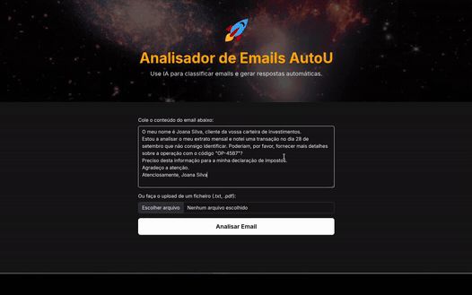
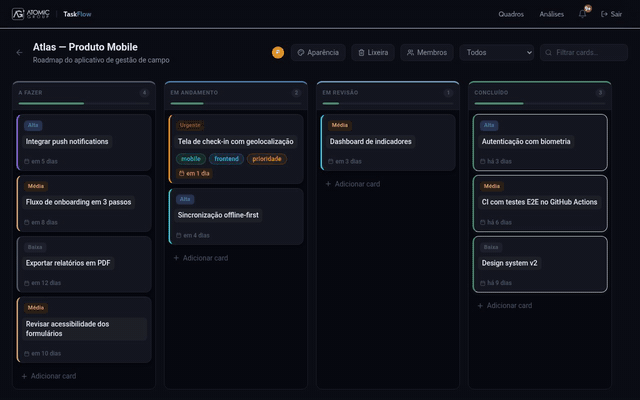
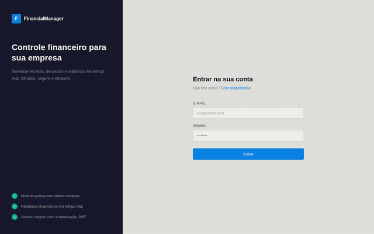
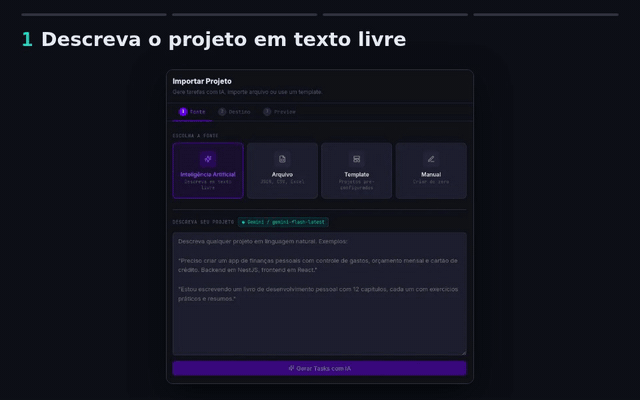

  

  

  

<h2 align="center"><code>$ ls projetos/</code></h2>

<table align="center" width="860" border="0" cellspacing="0" cellpadding="0">
<tr>
<td width="420" align="center" valign="top">
  
  <h3>Kurio</h3>
  
Marketplace de NFTs com checkout e tempo real.

  
21 testes E2E · testes unitários e visuais Lighthouse · React · TypeScript

  
<a href="https://kurio-nft-pompeu.netlify.app/"><strong>Testar →</strong></a>

</td>
<td width="420" align="center" valign="top">
  
  <h3>Analisador de Emails AutoU</h3>
  
Classifica e-mails e sugere respostas com Gemini.

  
CI com lint e tipos · 16 arquivos de teste Flask · Gemini · demo em vídeo

  
<a href="https://youtu.be/SMAO35yRlm8"><strong>Vídeo →</strong></a>

</td>
</tr>
</table>

<table align="center" width="860" border="0" cellspacing="0" cellpadding="0">
<tr>
<td width="286" align="center" valign="top">
  
  <h4>TaskFlow</h4>
  
Kanban colaborativo em tempo real 15 E2E · NestJS · WebSocket · Docker

  
<a href="https://github.com/pedropompeu/TaskFlow-Atomic"><strong>Código →</strong></a>

</td>
<td width="286" align="center" valign="top">
  
  <h4>FinancialManager</h4>
  
SaaS financeiro multiempresa 18 testes de API · isolamento entre empresas Django · React · PostgreSQL

  
<a href="https://github.com/pedropompeu/financial-manager"><strong>Código →</strong></a>

</td>
<td width="286" align="center" valign="top">
  
  <h4>Tasko</h4>
  
A IA monta o quadro do Trello a partir de um texto Win · Mac · Linux · Electron · 4 IAs

  
<a href="https://github.com/pedropompeu/Tasko-Import-Trello/releases"><strong>Baixar →</strong></a>

</td>
</tr>
</table>

  

  

<h2 align="center"><code>$ contato</code></h2>

  <strong>Aberto a oportunidades</strong> 
  <a href="https://www.linkedin.com/in/pedro-pompeu/">LinkedIn</a> ·
  <a href="mailto:pedrolpompeu@gmail.com">pedrolpompeu@gmail.com</a>

